Backend engineer focused on developer tooling, automation and CI/CD. I build small, well-tested services and the tooling around them, and I contribute fixes to open-source projects where I can verify the change end to end. I use AI assistants as a tool in that work; everything I submit is reviewed by me and tested locally first.

## Projects

**Task Forge**: an internal tool for tracking the open-source issues I work on and running each repository's own tests before anything is submitted.

## Open-source contributions

- **Perenna-Labs/perenna-contracts** (Rust, Soroban): collapsed duplicated event-emit signatures behind one helper ([#140](https://github.com/Perenna-Labs/perenna-contracts/pull/140)); return `InvalidTimeRange` instead of a math overflow on bad stream bounds ([#157](https://github.com/Perenna-Labs/perenna-contracts/pull/157)); repaired integration regressions after a merge ([#158](https://github.com/Perenna-Labs/perenna-contracts/pull/158))
- **Presago-Labs/presago-contracts** (Rust): archived stale `issues/issue-*.md` files ([#102](https://github.com/Presago-Labs/presago-contracts/pull/102)); retired `ISSUE_DRAFT.md` after the defects it tracked were fixed ([#103](https://github.com/Presago-Labs/presago-contracts/pull/103))
- **Presago-Labs/presago** (JavaScript): removed an obsolete PowerShell maintenance script and its references ([#132](https://github.com/Presago-Labs/presago/pull/132))
- **BasedHardware/omi** (Python): authentication on seven `/tools/*` routes of the WHOOP integration ([#21133](https://github.com/BasedHardware/omi/pull/21133), in review)

## Tech

Python, FastAPI, LLM tooling (open-weight models, OpenAI-compatible APIs), Rust (Soroban smart contracts), JavaScript, Shell, Docker, nginx.

## Contact

Open to backend, tooling and CI work, and to open-source collaboration. GitHub issues or discussions on my repositories are the quickest way to reach me.

The cards above are SVGs generated by <code>assets/build.py</code>.
